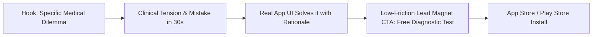

# The AI Content Engine (EUNACOM Edition)

> **Core Objective:** High-volume, authentic short-form video production (Instagram Reels, TikTok, YouTube Shorts) designed to convert views into **EUNACOM App downloads**. Built for a solo medical creator wearing a clinical coat/scrubs, powered by real phone footage, real app screen recordings, automated silence cutting, kinetic captions, and a 3–5 hook test matrix. Zero synthetic avatars. Zero editors on payroll.

---

## 1. Competitive Intelligence: The EUNACOM Landscape

Understanding what competitors do—and where their content falls short—is our core strategic advantage:

| Competitor | Their Content Angle | Where They Fail / Our Asymmetric Advantage |
|---|---|---|
| **Dr. Guevara** | Traditional high-yield summaries, mnemonics, "preguntas fijas". Strong personal brand. | **Outdated, slow-paced video format.** Long-form, blackboard/lecture style. No modern mobile app experience. We win on speed, modern UI, and fast bite-sized cases. |
| **EunaMed** | Webinars, "garantía de aprobación", corporate webinars, adult learning theory. | **Corporate and dry.** Low engagement on TikTok/Reels. Hard-selling expensive courses instead of providing immediate clinical dopamine in 45 seconds. |
| **CTO / AMIR** | Massive Spanish MIR manuals, deep academic theory. | **Overkill & intimidating.** Content feels too dense, Spanish-centric, and poorly adapted to Chilean primary care (APS/GES/Minsal). We focus 100% on high-yield Chilean Perfil V3. |

### The EUNACOM App Moat
We don't sell a \$500 static PDF course in our videos. We offer **an interactive, mobile-first training app** with real timers, active recall, and instant rationales.

---

## 2. The App Download Conversion Playbook (How to Maximize Installs)

Viewers on TikTok and Reels do not click "download" just because a video asks them to. To maximize conversion:

### Conversion Rule 1: The "Diagnostic Scorecard" Lead Magnet
- **Do NOT say:** *"Descarga mi app para estudiar EUNACOM."* (Zero curiosity).
- **DO say:** *"¿Aprobarías el EUNACOM hoy? Haz el mini-simulacro de 10 preguntas de [Cardiología] con el timer oficial. El link está en la bio."*

### Conversion Rule 2: The Unresolved Clinical Challenge (Curiosity Loop)
Give a high-yield clinical case, dissect the #1 distractor option, and state:
> *"La justificación completa de la guía Minsal y las otras 4 preguntas clave de este tema están en el simulacro gratis de EUNACOM App."*

### Conversion Rule 3: Comment Automation Trigger (Algorithm Booster)
Ask viewers to comment a specific keyword to receive the test via DM:
> *"Comenta **SIMULACRO** y te mando el acceso al test diagnóstico de 10 preguntas directo a tus mensajes."*
*(Drives 5x–10x comment volume, signaling high engagement to the algorithm).*

---

## 3. On-Camera Persona & Production Aesthetics

- **Persona:** **Clinical Mentor (Doctor in White Coat or Scrubs)**.
  - Credible, empathetic, authoritative, direct.
  - Speaks doctor-to-doctor: *"Colega, si te aparece esto en el turno o en el examen..."*
- **Aesthetic & Pacing:**
  - Snappy, zero dead air (silence cut at `>300ms`).
  - High-yield energy: get straight into the case within the first 1.5 seconds.
- **Captions (Non-Negotiable for 80%+ Muted Retention):**
  - 9:16 vertical placement (centered vertical safe zone).
  - Bold, high-contrast, kinetic typography (yellow/cyan emphasis words).
  - Keeps viewers reading even when sound is off in transit or hospital corridors.

---

## 4. Context-to-Screen B-Roll Matrix (Real App Assets)

Never show generic stock footage. Match the spoken word to real EUNACOM app screens:

| Spoken Topic / Pain Point | Real App Screen to Show (B-Roll Overlay) |
|---|---|
| Spoken clinical question | **EUNACOM Question Screen** with options A, B, C, D, E. |
| Time pressure / anxiety (1 min per question) | **Simulacro Countdown Timer** ticking down. |
| Why option C was wrong | **Clinical Explanation Card** with Minsal rationale highlighted. |
| Specialty weighting (Medicina Interna 37%, Pediatría 16%) | **Perfil V3 Competency Radar / Score Breakdown**. |
| Progression / Passing the 51% bar | **Analytics Dashboard** showing score jumping from 58% to 76%. |

---

## 5. The 5 Core Operating Rules

1. **Real Face on Camera:** Clinical mentor in scrubs/white coat. Authentic medical authority.
2. **Real App Assets Only:** Real screen captures and UI grabs from `eunacomapp.cl`.
3. **Cut Silence, Never Words:** Remove pauses (`>300ms`) via ffmpeg. Never rearrange medical logic.
4. **3 to 5 Hook Variations per Video:** Same body, different 3-second opening hook. Volume finds the winner.
5. **Human Quality Gate:** Machine drafts and renders; creator approves before publishing.

---

## 6. Weekly Performance Feedback Loop

Every Sunday:
1. Drop screenshots of Instagram Reels / TikTok analytics into `Content/Performance/`.
2. Review retention curves, hook drop-off rates, and top-converting topics.
3. Automatically update `Content/CLAUDE.md` with winning hook styles and clinical topics.
